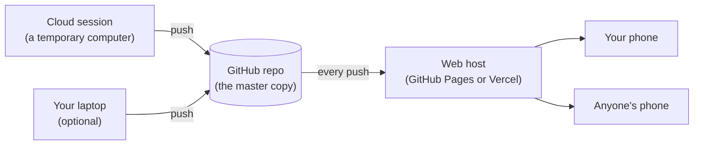

# Don Quixote, the game: deep dive

November 2026. Research and recommendations before any real build. A two-minute playable taste of the recommended direction lives in [`prototype/`](../prototype/index.html).

## The short version

- **Build it.** The idea is better than most literary-game ideas because the book's central theme converts directly into a game rule: you can read every scene two ways, and the more fun reading costs you. The risk is not the idea. It is that nobody finds the game, so the plan has to include distribution from day one.
- **Make it a web game designed for a phone held in one hand.** It opens from a link, installs to the iPhone Home Screen, and can be built, tested and published entirely from cloud sessions. Put it in the App Store later, and only if players show up.
- **Start with Path 1 (a swipe-choice game) and grow it into Path 2 (a road-trip game with a map and pursuers).** Path 1 is the smallest thing that can be fun, and its scenes are reusable as the encounters of Path 2.
- **Building in the cloud is fine for this.** Your instinct is right for one case only: a native iPhone app needs a Mac. A web game does not need your computer at any point.

## 1. What would make this game succeed

### 1.1 What the successful adaptations did

| Game | Source | What it kept | What happened |
|---|---|---|---|
| Black Myth: Wukong (2024) | *Journey to the West* | The cast, the world, the hero's powers. Not the plot. | About 30 million copies by mid-2026 |
| 80 Days (2014) | *Around the World in Eighty Days* | The wager and the clock, turned into route planning. About 750,000 words of new writing. | TIME's Game of the Year 2014 |
| Reigns series (2016 onward) | Original, then *Game of Thrones*, *Romance of the Three Kingdoms*, *The Witcher* | One gesture (swipe left or right) that fits any story about hard choices | 600,000 sold in the first month, about 2 million by 2019, 4 million players across the series |
| The Great Gatsby "for NES" (2011) | *The Great Gatsby* | The characters, played as a joke | A free browser game that spread across the internet in a week |
| A Dark Room (2013) | Original | n/a | Free browser game first, then the #1 paid iPhone app in the US for 17 days |
| Vampire Survivors (2021) | Original | n/a | Started as a free browser game; became one of the biggest indie hits of the decade |

And the ones that did not work:

| Game | What it did | What happened |
|---|---|---|
| Quijote: Quest for Glory (2022) | A tactical card game with Cervantes's characters on the cards | Fewer than 15 reviews on Steam |
| Donkey Xote (2008) | A film tie-in platformer | Forgotten |
| Dante's Inferno (2010) | A famous poem pasted onto a borrowed action template | Remembered mostly as a curiosity |

Three lessons come out of this.

1. **The famous title does not bring players.** People do not download a game because they respect the book. They play because a friend sent a link and the first thirty seconds were fun.
2. **The winners found the one action that is the book.** 80 Days is about racing a clock, so you plan routes against a clock. The losers put the book's characters on top of a game that would work the same without them.
3. **Your instinct about fidelity is correct.** Plot accuracy is optional. What must be faithful is the feeling. The plot can then be taught on the side, the way Assassin's Creed does with its optional encyclopedia.

### 1.2 The action that is Don Quixote

The book runs on one joke that turns into one sadness. Don Quixote looks at a windmill and sees a giant. He is wrong, he gets hurt, and yet his version of the world is braver and more generous than the real one. The reader spends a thousand pages unsure whether to laugh at him or side with him.

So the player's core action should be: **choose which world to believe, and pay for it.**

- **Two readings of everything.** Windmill or giant. Inn or castle. Barber's basin or the golden helmet of Mambrino. Farm girl or Dulcinea.
- **The dream must be the more tempting choice.** It gives glory and better stories. It also costs teeth, money and Sancho's patience. If the sensible option were also the fun one, there would be no game and no book.
- **Refusing the dream must also lose.** A player who always picks the sensible option should watch the adventure die. That is the book's actual ending: he wakes up sane, and then he dies.
- **Sancho's compromise is the skill.** When two characters argue over whether the object is a basin or a helmet, Sancho calls it a *baciyelmo*, a basin-helmet. Playing well means finding the basin-helmet: enough dream to stay a knight, enough sense to stay alive.
- **Losing is content.** He loses nearly every fight. Each defeat should be funny and should be the thing players tell each other about.
- **The pair is the heart.** Tall thin idealist, short round realist. Over the book each slowly becomes more like the other. The game can track that.
- **Part Two is a gift for a sequel act.** In the second volume, everyone he meets has read the first volume. The world knows who he is and starts staging fake adventures to laugh at him. In a game, the world can react to what you did in your last run.

### 1.3 Seven requirements

1. **One thumb, upright phone, two-to-five-minute sessions.** Most people will open it on a phone. In a 2026 survey of web-game players, 46% of mobile players had quit a game over loading time and 28% over download size, so it must load in a couple of seconds.
2. **Funny in the first thirty seconds.** The novel is a comedy. If the game reads like homework, it has failed.
3. **Teach by consequence, then offer the footnote.** The player frees the galley slaves and gets stoned by them. Only afterwards does a short "In the book" note say what Cervantes wrote. Nobody is forced to read it. Players who do come away knowing the plot.
4. **A reason to play again and a reason to share.** Runs should differ. Each run should end with something worth sending to a friend. The taste generates a chapter title in Cervantes's long-winded style from the player's own choices.
5. **A look we can afford.** There is no artist. The art has to be drawn in code or taken from the public domain, and that limit should become the style rather than be hidden.
6. **English and Spanish from the start.** About 635 million people speak Spanish and the novel is school reading across the Spanish-speaking world. A teacher can share a link with a class. A teacher cannot install an app on thirty school devices.
7. **A plan for being found.** See section 4.

### 1.4 What is free to use

| Free (public domain) | Not free |
|---|---|
| The novel itself, in Spanish (1605, 1615) | Modern translations (Grossman, Rutherford, Raffel and others) |
| John Ormsby's English translation (1885), on Project Gutenberg | *Man of La Mancha* and "The Impossible Dream". That line is from the 1965 musical, not from Cervantes. |
| Gustave Doré's engravings (1863), several hundred of them | Picasso's famous 1955 ink sketch |

Real quotations in both languages and the most recognizable Quixote artwork ever made cost nothing.

## 2. Who else is making Quixote games

| Game | Year | What it is | Status |
|---|---|---|---|
| Super Don Quix-ote | 1984 | Arcade laserdisc game, Quixote in name only | Historical |
| Don Quijote (Dinamic) | 1987 | Spanish text adventure | Historical |
| Donkey Xote | 2008 | Film tie-in | Forgotten |
| Quijote: Quest for Glory | 2022 | Tactical card game on PC | Released, almost no audience |
| Hidalgo | announced 2026 | Cozy co-op adventure in a handmade puppet world, PC. Raised about $57,000 on Kickstarter. | In development |
| Al Buen Callar Llaman Sancho | upcoming | 3D action-adventure where you play as Sancho | "Coming soon" on Steam |

What this means:

- **Nobody has made the phone game.** Every current project is a PC or console game. A short, funny, link-shareable Quixote for phones is open ground.
- **Nobody has had a hit.** There is no beloved Quixote game to be compared against.
- **Two looks are taken.** Hidalgo owns the puppet-theater look, and the Sancho project owns "3D action as Sancho". The art direction should stay away from both.

## 3. Five paths

All five use the same core idea (two readings of every scene). They differ in what kind of game carries it.

### Path 1. Two Worlds: a swipe-choice game

**The pitch.** Each scene is a page. Drag it left to believe Sancho, right to believe Don Quixote. The picture changes under your thumb as you lean. Four meters (Glory, Body, Purse, Sancho) must all stay above zero.

- **Plays like:** Reigns. One gesture, quick runs, many different ways to fail.
- **Why it is Quixote:** the control scheme is the book's argument. Left hand realism, right hand idealism.
- **Teaches:** a lot of plot. Every page is an episode, and every outcome carries an "In the book" note.
- **Size:** small. The engine is simple and the work is mostly writing, in two languages.
- **Risks:** the format is well known, so it needs its own identity (the picture that changes as you lean, a third "basin-helmet" option, a real story arc across three journeys). It needs about 150 to 300 well-written scenes to stay fresh.
- **The taste in `prototype/` is this path**, with 13 scenes from Part One.

### Path 2. The Road: outrun the people trying to cure you

**The pitch.** A map from La Mancha to Barcelona. You choose the route between inns, mills and mountains while your priest, your barber and the graduate Sansón Carrasco close in to drag you home. Each stop is an encounter with two readings. Manage Rocinante's legs, the purse and Sancho's patience. Three journeys, as in the book.

- **Plays like:** 80 Days for the travelling, FTL for the pursuit.
- **Why it is Quixote:** the novel is a road trip, and it really is about sensible people chasing a dreamer. Here reality is a piece on the map getting closer.
- **Teaches:** the most of any path. Geography, the order of events, the full cast, and the Part Two twist where the world has read about your last run.
- **Size:** medium. Map, travel resources, pursuit, and several times the writing of Path 1.
- **Risks:** text-heavy games appeal most to readers. It needs a strong travel system so it does not feel like a book with buttons.
- **Note:** Path 1's scenes become this game's encounters, so Path 1 is not wasted work.

### Path 3. The Library: a deck-building game

**The pitch.** His madness came from books, so your deck is his library. Cards are things he read (Amadís of Gaul, enchanters, oaths) and Sancho's proverbs. You decide what each enemy is: fight the windmill as a giant for a big reward, or leave it a windmill for nothing. Between acts the priest and barber burn part of your library, as they do in chapter 6.

- **Plays like:** Slay the Spire, Balatro.
- **Why it is Quixote:** books as power, naming as power, and the book-burning as a real game event.
- **Teaches:** less plot than the others. Combat abstracts the story away.
- **Size:** large. Roughly 80 cards, dozens of enemies, and a long tuning phase.
- **Risks:** this genre's players are experts and will compare it with the best. One warning sign already exists: a Quixote card game shipped on Steam in 2022 and found almost no audience. On the other hand, Balatro (one developer, over 5 million copies) shows the ceiling when the twist is fresh.

### Path 4. The Squire: stage the world to steer the knight

**The pitch.** You are not Don Quixote. You are the people around him. He moves by a fixed rule: he charges at whatever looks most like an adventure. Each level is a small board, and you rearrange it before he gets there. Hide the basin. Bribe the mule drivers. Dress someone up as a princess to lure him home, which is exactly what his friends do in the novel.

- **Plays like:** Hitman GO or Lemmings. Turn-based puzzles around a character you cannot control.
- **Why it is Quixote:** it puts you in Sancho's position, and over time you start feeding the dream on purpose because he is happier that way. That is Sancho's actual story.
- **Teaches:** episodes well, one per level.
- **Size:** medium, but the design is hard. Good puzzles need a lot of testing with real people.
- **Risks:** the highest design risk, and a narrower audience. An upcoming PC game also plays as Sancho, though as 3D action. The retelling-from-the-sidekick idea has worked before (Elsinore retold Hamlet through Ophelia).

### Path 5. Mad Dash: five-second microgames

**The pitch.** The whole novel as rapid-fire five-second challenges. The screen shouts "SLAY THE GIANT!", you tap in time, and then it shows what really happened: you hit a windmill. Next: "DON'T PAY!", "CATCH SANCHO!", "FREE THEM!". It speeds up until you fail.

- **Plays like:** WarioWare, Dumb Ways to Die (over 100 million downloads for the original).
- **Why it is Quixote:** the gap between the instruction and the result is the joke. It carries less of the sadness.
- **Teaches:** the greatest hits only.
- **Size:** small to medium. Twenty to thirty tiny games. Rough art is acceptable in this genre.
- **Risks:** it depends on timing and feel, which is the hardest thing to tune without a person testing every build on a real phone. That person would be you.

### Side by side

| | Fun ceiling | Fits a phone | Teaches the book | Risk of a bad build | First playable |
|---|---|---|---|---|---|
| 1. Two Worlds | Medium-high | Excellent | High | Low | Exists now |
| 2. The Road | High | Very good | Highest | Medium | Weeks |
| 3. The Library | Highest | Good | Low-medium | High | Many weeks |
| 4. The Squire | High if it clicks | Very good | High | High | Weeks |
| 5. Mad Dash | Medium-high | Excellent | Low | Medium | 1 to 2 weeks |

### What is not on the list

A 3D open-world Quixote in the style of Assassin's Creed or Hogwarts Legacy. Those games take hundreds of people and several years, and they do not run in a phone browser. What is worth borrowing from them is their attitude: the source is a world to play in, and the facts live in an optional encyclopedia.

## 4. Recommendation

**Build Path 1 first and let it grow into Path 2. Borrow Path 5's five-second challenges for the big set pieces. Keep Paths 3 and 4 as later bets.**

Reasons:

- It is the path where the weakest parts of this setup matter least. There is no artist and no one tuning game-feel by hand every day, and Path 1 depends on writing and simple rules, which a cloud session can produce and test automatically.
- It reaches a real, shareable game fastest, so you find out early whether people care.
- Nothing is thrown away if it works. The scenes become encounters on The Road.

### Milestones, each with a test

| Step | What exists | The test before continuing |
|---|---|---|
| 0. Taste (done) | 13 scenes, one ending screen | Do you enjoy it yourself? |
| 1. First journey | About 40 scenes of Part One, English and Spanish, sound, saved progress, a share image, a permanent web address | Give the link to ten people without explaining it. Do at least six finish a run, and do at least three play again unprompted? |
| 2. The Road | Map, pursuit, three journeys, the Part Two twist | Do people come back on a second day? |
| 3. Launch | Public release | Target 23 April, which is World Book Day and the day Spain marks Cervantes's death |
| 4. App Store | The same game wrapped as an iPhone app | Only if step 3 shows real demand |

If step 1 fails its test, the cheap move is to try Path 5 or Path 4 with the same art and writing rather than push on.

### Being found

- **The link is the product.** No sign-up and no download. Every run ends in something worth sending.
- **itch.io** for the indie audience, and the relevant Reddit communities.
- **Spanish teachers and literature teachers.** A free bilingual game that covers the plot in fifteen minutes is something they will pass around.
- **Web game portals later.** Poki reports more than 100 million monthly players and CrazyGames about 60 million. Both share ad revenue with developers. In Poki's 2026 survey, 62% of web players said they had gone on to download or buy a game after first playing it in a browser, which supports going web-first and App Store second.

## 5. Web game or iPhone app

| | Web game, installable to the Home Screen | Native iPhone app |
|---|---|---|
| How someone gets it | Taps a link. Plays in two seconds. | Finds it in the App Store, downloads, opens |
| Looks like an app? | Yes, once added to the Home Screen: own icon, full screen. Since iOS 26, any site added to the Home Screen opens this way by default. | Yes |
| Cost to publish | Free hosting | Apple Developer Program, $99 a year |
| Who can build it | A cloud session, start to finish | Needs a Mac with Xcode, or a rented cloud Mac |
| Testing on your phone | Open the link | TestFlight: Apple reviews the first build, builds expire after 90 days |
| Updates | Live the moment they are pushed | Each update goes through App Review |
| Being found | Links, communities, web portals | App Store search, which sends almost nothing to an unknown game with no ad budget |
| Charging money | Awkward | Easy |
| Sharing with a class | A link works on any device | Thirty installs |
| Weak spots | No store listing. Sound starts only after the first tap. No real vibration feedback. | Slow loop. Apple can reject an app that is just a wrapped website, so it has to work offline and feel native. |

One detail matters for saved progress: Safari can clear a website's stored data after seven days without a visit, but a game added to the Home Screen is exempt. Installing it protects the save file.

The mobile market is enormous (about $121 billion of a $214 billion games market in 2026), but that money sits with a few giant free-to-play games that buy their players with advertising. For a new game from an unknown maker, the App Store offers credibility and a way to charge. It does not offer an audience.

**Verdict: web first.** If the game finds players, wrap the same code as an iPhone app (the standard tool is called Capacitor) and submit it. That is a week or two of work at that point, and by then you will know it is worth $99 and a Mac.

## 6. Building in the cloud versus on your computer

There are three places, and they are easy to mix up.

1. **The master copy** is the repository on GitHub. Code, pictures, sound and text all live there.
2. **A workshop** is any computer holding a working copy. A software engineer's laptop is one. This cloud session is another. Neither is the master.
3. **The stage** is the web host that turns the files into an address people can open.

Your suspicions, one at a time:

| What you suspected | Verdict |
|---|---|
| Engineers build on their own computer and sync with GitHub, so that is the right way | Half right. They work on a copy and GitHub holds the master. The copy is on their laptop because their tools are there. A cloud session is the same arrangement on a rented computer. |
| The cloud can update the repo, but then I cannot see or install the result | True for a native iPhone app. Not true for a web game: push, the host publishes it, you open the link. |
| Assets need somewhere to live that every device can reach, and that means building a lot of extra things | No. Pictures and sound sit in the repo next to the code. The host copies them to its servers on every publish and every device loads them from the same address. Separate storage only matters for very large media. |
| Building in the cloud is not always best | Correct, in three cases: native iPhone or Android builds, art or audio made in desktop apps, and anything needing a device plugged in. |

Two more things worth knowing:

- **The cloud computer is temporary.** Anything not pushed to GitHub disappears when the session ends. Everything from this session has been pushed.
- **Players' progress is saved on their own phone.** Syncing progress between devices, or a leaderboard, needs a small online database. That can be added later and is not needed to launch.

If you want your laptop involved later, there are two bridges. Remote Control runs the session on your own computer while you steer it from your phone. `claude --teleport` pulls a cloud session down into your laptop's terminal. Both need the laptop switched on.

## 7. Playing builds on your phone

1. **Right now:** the private link in the chat. It opens in the Claude app or Safari.
2. **A permanent address:** GitHub Pages, free because the repository is public. In the repository on GitHub: Settings, then Pages, then "Deploy from a branch", choose `main` and `/ (root)`, Save. A minute later the game is at `https://migueljsalazar.github.io/donquixote/`. It republishes on every merge.
3. **Make it an app icon:** open that address in Safari, tap Share, then "Add to Home Screen".
4. **Optional:** connect the repository to Vercel to get a separate preview link for every work-in-progress branch, so you can try a change before it is merged.

Note that the repository is public, so the code and these documents are visible to anyone who looks.

## 8. Decisions still open

1. Which path. The recommendation is Path 1 growing into Path 2.
2. A name. Candidates: *Two Worlds*, *Sally Forth*, *Baciyelmo*, *The Sorrowful Face*.
3. Whether to turn on GitHub Pages (step 2 above).
4. English and Spanish together from the first real build, or English first.

## Sources

- Black Myth: Wukong sales: [VGChartz](https://www.vgchartz.com/article/468242/black-myth-wukong-sales-top-30-million-units/)
- 80 Days word count: [PC Gamer](https://pcgamer.com/inkles-globetrotting-adventure-80-days-hits-pc)
- Reigns sales: [PocketGamer.biz](https://www.pocketgamer.biz/tinder-esque-indie-strategy-reigns-600000-downloads), [PCGamesInsider](https://www.pcgamesinsider.biz/success-story/66428/how-tinder-meets-game-of-thrones-title-reigns-sold-18m-copies/); Reigns: The Witcher: [Devolver Digital](https://www.devolverdigital.com/propaganda/announcing-reigns-the-witcher-coming-february-25)
- The Great Gatsby browser game: [Engadget](https://www.engadget.com/2011-02-15-great-gatsby-nes-game-borne-back-ceaselessly-onto-the-internet.html)
- A Dark Room: [Dallas Morning News](https://dallasnews.com/business/2014/05/24/how-a-text-based-rpg-got-to-no-1-on-ios-app-store)
- Vampire Survivors' browser origins: [Phaser](https://phaser.io/news/2024/02/vampire-survivors-space-54)
- Balatro sales: [PocketGamer.biz](https://www.pocketgamer.biz/balatro-exceeds-5-million-in-sales-on-all-platforms)
- Dumb Ways to Die downloads: [mobilegamer.biz](https://mobilegamer.biz/dumb-ways-to-die-tops-charts-passes-100m-lifetime-downloads-after-tiktok-trend/)
- Quijote: Quest for Glory: [Steam](https://store.steampowered.com/app/1924020)
- Hidalgo: [Massively Overpowered](https://massivelyop.com/2025/05/18/hildalgo-is-a-don-quixote-themed-cozy-co-op-game-that-funded-on-kickstarter-for-57k), [Noisy Pixel](https://noisypixel.net/hidalgo-don-quixote-adventure-game-announced/)
- Al Buen Callar Llaman Sancho: [Steam](https://store.steampowered.com/app/4897970)
- Super Don Quix-ote: [Wikipedia](https://en.wikipedia.org/wiki/Super_Don_Quix-ote)
- Web gaming survey and Poki audience: [Poki, State of Web Gaming 2026](https://poki.com/blog/state-of-web-gaming-report-2026)
- Games market 2026: [God is a Geek on Newzoo's forecast](https://godisageek.com/2026/08/global-games-market-2026/)
- Home Screen web apps in iOS 26: [MacRumors](https://www.macrumors.com/2025/06/18/safari-changes-on-ios-26/), [firt.dev](https://firt.dev/notes/pwa-ios/)
- Safari's seven-day storage rule: [WebKit](https://webkit.org/?p=10218)
- TestFlight limits: [Apple](https://www.developer.apple.com/help/app-store-connect/test-a-beta-version/invite-external-testers)
- Spanish speakers: [Euronews on the Instituto Cervantes yearbook](https://es.euronews.com/2025/10/28/el-espanol-suma-30-millones-de-hablantes-y-alcanza-los-635-millones-en-el-mundo)
- Doré's engravings: [Open Culture](https://openculture.com/2013/12/gustave-dores-definitive-engravings-of-don-quixote.html)
- Cloud sessions, the mobile app and Remote Control: [Claude Code docs](https://code.claude.com/docs/en/claude-code-on-the-web), [mobile](https://code.claude.com/docs/en/mobile), [Remote Control](https://code.claude.com/docs/en/remote-control)
